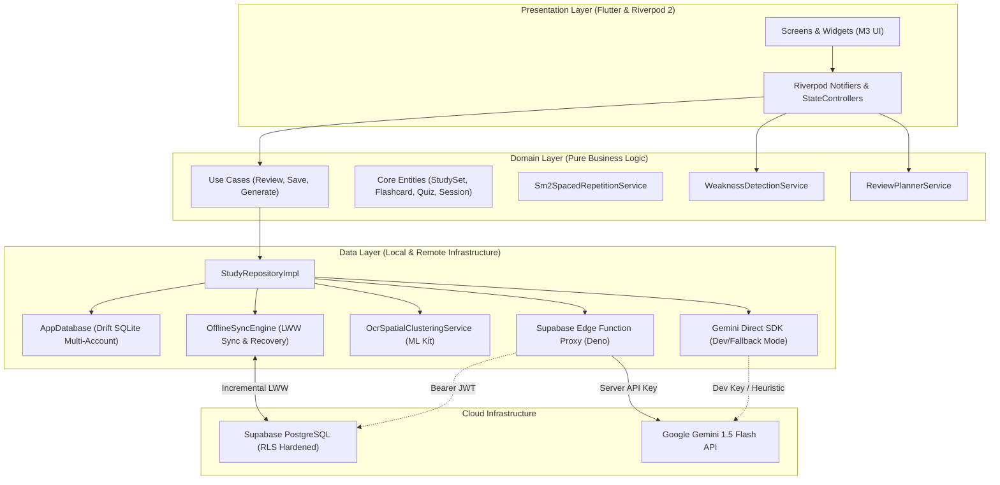

# 🧠 NOTEFLOW AI — Smart Study Notes & Personalized Revision

**Đồ án Capstone Học phần Phát triển Ứng dụng Di động Đa nền tảng (Flutter & Dart 3)**  
**Khoa Khoa học Máy tính — Trường Đại học Công nghệ Thông tin và Truyền thông Việt - Hàn (VKU)**  
**Giảng viên hướng dẫn:** TS. Nguyễn Thanh Tuấn  
**Tác giả:** Đội ngũ phát triển NoteFlow VKU  
**Phiên bản:** 1.1.0+1 (Phase 5 — Production Readiness Release)

---

## 1. GIỚI THIỆU TỔNG QUAN DỰ ÁN (PROJECT OVERVIEW)

**NoteFlow AI** là trợ lý học tập thông minh đa nền tảng, thiết kế chuyên biệt cho sinh viên khối ngành Khoa học Máy tính & Công nghệ Thông tin. Ứng dụng chuyển đổi các tài liệu học tập thô (ảnh chụp bảng, slide bài giảng, giáo trình PDF) thành hệ thống học liệu có cấu trúc cao (Tóm tắt trọng tâm, Thẻ ghi nhớ Flashcard, Bộ câu hỏi trắc nghiệm khách quan), kết hợp thuật toán lặp lại ngắt quãng **SuperMemo SM-2**, phân tích điểm yếu học tập thích ứng và lập kế hoạch ôn tập cá nhân hóa hằng ngày.

### Điểm nổi bật kỹ thuật:
- **Offline-First Kiến trúc Cốt lõi:** Toàn bộ dữ liệu học tập, phiên ôn tập SM-2, làm bài quiz, nhận diện OCR và bộ tổng hợp câu hỏi mẫu ngoại tuyến (Offline Heuristic Synthesis) hoạt động 100% không cần kết nối mạng thông qua SQLite (Drift ORM) với cơ chế cách ly tài khoản người dùng (`AppDatabase.forUser(userId)`). Tính năng sinh học liệu Generative AI và đồng bộ đám mây tự động kích hoạt khi có kết nối mạng.
- **On-Device Vision AI:** Xử lý OCR hoàn toàn trên thiết bị bằng Google ML Kit Text Recognition kết hợp thuật toán **Spatial Row Clustering** để phân tách cột và tái lập trật tự đọc tự nhiên 2D.
- **Generative AI & Context Grounding:** Sinh học liệu tự động qua Google Gemini 1.5 Flash. Trợ lý AI Study Assistant trả lời bám sát ngữ cảnh bài giảng, kiểm tra căn cứ trích dẫn chống ảo giác học thuật (Anti-Hallucination) và tạo câu hỏi tự luyện an toàn (Draft Mode).
- **Hạ tầng An ninh Production-Ready:** Thiết kế kiến trúc **Supabase Edge Function Proxy** (`gemini-study-assistant`) bảo vệ API Key trên backend đám mây, tích hợp cơ chế làm sạch logs/exceptions và Release Safety Guard.

---

## 2. TÍNH NĂNG CHÍNH (KEY APPLICATION FEATURES)

1. **Document Scanning & Spatial OCR:**
   - Chụp ảnh hoặc tải lên tài liệu học tập, hỗ trợ cắt xoay linh hoạt qua `UCropActivity`.
   - Gom cụm không gian hình học (Spatial Row Clustering) với ngưỡng chồng lấp trục tung $\ge 55\%$ và khoảng cách cột $2.4\times$, bảo toàn định dạng văn bản nhiều cột.
2. **AI Study Set Generator:**
   - Tự động phân tích văn bản bài giảng và sinh đồng thời 3 thành phần: Bản tóm tắt học thuật Markdown, Danh sách thẻ Flashcard SM-2 và Bộ câu hỏi trắc nghiệm 4 lựa chọn có giải thích chi tiết.
   - Hỗ trợ xem trước và chỉnh sửa trực tiếp nội dung trước khi lưu vào cơ sở dữ liệu.
3. **Flashcard Review với Thuật toán SuperMemo SM-2:**
   - Giao diện thẻ 3D Matrix4 chân thực với mục tiêu mượt mà 60 FPS (tối ưu hóa phần cứng qua CustomPainter và AnimationController; chưa thực hiện đo kiểm benchmark frametime trên thiết bị vật lý).
   - Tự động tính toán lại $EF'$, $I$ và $n$ theo thang đánh giá 4 mức độ: Again ($q=1$), Hard ($q=2$), Good ($q=4$), Easy ($q=5$).
   - Lưu trữ tiến độ phiên học dở dang (Partial Session Persistence) đảm bảo không mất lịch sử ôn tập.
4. **Phòng Thi Quiz Bấm Giờ & Thống Kê:**
   - Làm bài trắc nghiệm bấm giờ, hiển thị giải thích chi tiết ngay khi chọn đáp án.
   - Thanh điều khiển ghim dưới đáy màn hình (Sticky Action Bar) tối ưu trải nghiệm công thái học.
5. **Trợ lý Học tập AI (AI Study Assistant):**
   - Đặt câu hỏi thấu đáo và nhận câu trả lời có trích dẫn căn cứ bài giảng cụ thể `[Căn cứ: ...]`.
   - Sinh câu hỏi tự luyện dạng bản nháp an toàn, chỉ lưu vào bộ thẻ khi sinh viên xác nhận.
   - Cơ chế dự phòng ngoại tuyến thông minh (Offline Heuristic Synthesis) gắn banner minh bạch khi không có API key.
6. **Chẩn đoán Điểm Yếu Học Tập (Smart Weakness Detection):**
   - Đánh giá đa chiều kết hợp Flashcard SM-2 và Quiz theo mô hình trọng số thích ứng qua 5 kịch bản (Cases A–E).
7. **Lập Kế Hoạch Ôn Tập Cá Nhân Hóa (Personalized Review Planner):**
   - Tự động phân bổ nhiệm vụ học tập ưu tiên hằng ngày (Thẻ quá hạn, Chủ đề yếu, Củng cố Quiz).
   - Kiểm tra an toàn tiến độ phiên học, chống đánh dấu hoàn thành sai lệch.
8. **Đồng Bộ Hai Chiều Offline-First:**
   - Đồng bộ hóa nền với Supabase qua thuật toán Last-Write-Wins (LWW) và xóa mềm (Tombstones).
   - Cách ly dữ liệu nhiều tài khoản trên cùng thiết bị.

---

## 3. CÔNG NGHỆ SỬ DỤNG (TECHNOLOGY STACK)

| Thành phần | Công nghệ | Phiên bản / Chi tiết |
| :--- | :--- | :--- |
| **Framework** | Flutter / Dart | Flutter 3.22+ • Dart 3.3+ |
| **Kiến trúc** | Clean Architecture 3 lớp | Domain (độc lập), Data (Drift, Supabase, AI), Presentation |
| **State Management** | Riverpod 2 | StateNotifier, StreamProvider, ProviderScope |
| **Cơ sở dữ liệu cục bộ** | Drift (SQLite ORM) | NativeDatabase (C/C++ runtime), Multi-account isolation |
| **Backend BaaS** | Supabase Cloud | PostgreSQL 15, Row-Level Security (RLS), Edge Functions |
| **On-Device Vision AI** | Google ML Kit | Text Recognition v2 + Spatial Clustering Service |
| **Generative AI** | Google Gemini 1.5 Flash | Structured JSON Schema output & Supabase Edge Function Proxy |
| **Thiết kế UI/UX** | Material Design 3 | Haptic feedback, Semantics Accessibility, CustomPainters |

---

## 4. KIẾN TRÚC HỆ THỐNG (SYSTEM ARCHITECTURE)



---

## 5. HƯỚNG DẪN CÀI ĐẶT & CHẠY DỰ ÁN (GETTING STARTED)

### Yêu cầu tiên quyết:
- Flutter SDK $\ge 3.22.0$ (kênh `stable`).
- Android SDK 34+ và JDK 17+.
- Thiết bị Android thật hoặc Máy ảo Android Emulator.

### Bước 1: Clone kho mã nguồn & cài đặt dependencies
```bash
git clone https://github.com/bbaotrungg/NoteFlow.git
cd NoteFlow
flutter pub get
```

### Bước 2: Chạy kiểm thử tự động (Test Suite)
Dự án được bảo vệ bởi **76 bài test tự động** (Unit, Widget, Local SQLite Integration):
```bash
flutter test
```

Kiểm tra phân tích tĩnh (Static Analysis):
```bash
flutter analyze
```

Kiểm tra chuẩn định dạng mã nguồn (Code Formatting):
```bash
dart format --output=none --set-exit-if-changed .
```

### Bước 3: Chạy ứng dụng

#### Lựa chọn A — Chế độ Khảo sát Nhanh (Offline Heuristic Demo):
Không cần cấu hình bất kỳ API Key nào. Ứng dụng tự động khởi tạo dữ liệu mẫu bài giảng VKU và kích hoạt bộ tổng hợp Offline Heuristic:
```bash
flutter run
```

#### Lựa chọn B — Chế độ Phát triển với Gemini Cloud AI & Supabase:
```bash
flutter run \
  --dart-define=GEMINI_API_KEY=AIzaSyYourDevApiKeyHere \
  --dart-define=SUPABASE_URL=https://teeojjfcmbvzjmtxxucs.supabase.co \
  --dart-define=SUPABASE_ANON_KEY=sb_publishable_fK8lwPEIJARBVc0BuPr6NA_U0Q6FoYP
```

---

## 6. HẠ TẦNG AN NINH & BẢN PHÁT HÀNH (SECURITY & PRODUCTION READINESS)

### 6.1. Kiến trúc Bảo vệ Khóa API (Gemini API Key Security)
- **Cảnh báo quan trọng:** Việc nhúng trực tiếp API Key qua `--dart-define` vào bản build APK release công khai **không an toàn** do chuỗi ký tự được nhúng vào file nhị phân `libapp.so`.
- **Giải pháp bảo mật hoàn thiện trong Giai đoạn 5:** Mã nguồn Supabase Edge Function Proxy đã được lập trình hoàn chỉnh tại [`supabase/functions/gemini-study-assistant/`](file:///e:/NoteFlow/supabase/functions/gemini-study-assistant/).
  - Xác thực người dùng qua Supabase JWT Bearer token.
  - Lưu giữ `GEMINI_API_KEY` bí mật trên Deno server environment.
  - Giới hạn tốc độ (Rate Limiting: 30 requests/phút).
  - Kiểm soát độ dài dữ liệu đầu vào chống tràn token.
- **Cờ kiểm soát bản phát hành (Release Safety Guard):**
  Trong [`AppConstants`](file:///e:/NoteFlow/lib/core/constants/app_constants.dart):
  ```dart
  static const bool isDirectKeyEmbeddedInRelease = kReleaseMode && geminiApiKey != '';
  static bool get isSafeForPublicDistribution => !isDirectKeyEmbeddedInRelease;
  static void enforceReleaseSafety() {
    if (isDirectKeyEmbeddedInRelease) {
      throw StateError('CRITICAL SECURITY VIOLATION: Direct Gemini API key embedded in release build.');
    }
  }
  ```
  Tại `main.dart`, phương thức `AppConstants.enforceReleaseSafety()` được gọi ngay khi ứng dụng khởi động. Nếu bản build release bị nhúng khóa trực tiếp qua `--dart-define`, ứng dụng sẽ fail-fast lập tức nhằm ngăn chặn tuyệt đối việc phát hành bản build không an toàn.

### 6.2. Biên dịch Bản Release APK
```bash
# Biên dịch APK Release an toàn (không nhúng khóa trực tiếp):
flutter build apk --release --dart-define=GEMINI_API_KEY=""

# File APK tạo ra tại:
# build/app/outputs/flutter-apk/app-release.apk (95.4MB)
```

---

## 7. CẤU TRÚC THƯ MỤC DỰ ÁN (PROJECT STRUCTURE)

```text
NoteFlow/
├── android/                                           # Android native config, permissions, UCropActivity
├── docs/                                              # Tài liệu kỹ thuật & Báo cáo đồ án
│   ├── presentation/                                  # Đề cương thuyết trình đồ án VKU
│   ├── reports/                                       # Báo cáo các giai đoạn (Phase 1 -> Phase 5)
│   └── technical_architecture.md                      # Tài liệu thiết kế kiến trúc kỹ thuật chi tiết
├── lib/
│   ├── main.dart                                      # Entrypoint, Supabase & ProviderScope init
│   ├── core/
│   │   ├── constants/app_constants.dart               # Hằng số, Edge Function config & Release Guard
│   │   ├── errors/failures.dart                       # Phân loại lỗi chuẩn Clean Architecture
│   │   ├── theme/app_theme.dart                       # Material 3 Design System (#0284C7 & #0F172A)
│   │   └── utils/date_time_utils.dart                 # Xử lý thời gian & định dạng tiếng Việt
│   ├── domain/                                        # Pure Business Logic (Independent of UI/DB)
│   │   ├── entities/                                  # 11 Domain Entities
│   │   ├── repositories/i_study_repository.dart       # Repository Interface Contract
│   │   ├── services/                                  # SM-2, Weakness Detection, Review Planner
│   │   └── usecases/                                  # Use Cases
│   ├── data/                                          # Data Layer (Drift, Supabase, ML Kit, Gemini)
│   │   ├── local/                                     # Tables, DAOs, AppDatabase Multi-Account
│   │   ├── repositories/study_repository_impl.dart    # Repository Implementation
│   │   ├── services/                                  # OCR Spatial Clustering, Gemini AI, AI Assistant
│   │   └── sync/offline_sync_engine.dart              # Two-way LWW Sync Engine
│   └── presentation/                                  # UI Layer (Material 3, Riverpod 2)
│       ├── providers/app_providers.dart               # Riverpod Providers & Notifiers
│       ├── screens/                                   # Dashboard, OCR Pipeline, StudySet, Flashcard, Quiz, AI Assistant
│       └── widgets/                                   # 3D Flashcard, Charts, Weakness, Review Plan
├── supabase/
│   ├── functions/gemini-study-assistant/              # Supabase Edge Function Proxy (Deno TypeScript)
│   └── migrations/                                    # PostgreSQL Schemas & Hardened RLS Policies
├── test/                                              # 76 Automated Tests (Unit, Widget, Integration)
└── pubspec.yaml                                       # Dependencies & Asset configuration
```

---

## 8. GIỚI HẠN HIỆN TẠI & HƯỚNG PHÁT TRIỂN (LIMITATIONS & FUTURE WORK)

- **Giới hạn môi trường Cloud:** Supabase Edge Function Proxy đã được lập trình hoàn chỉnh trong mã nguồn nhưng đang chờ người dùng phê duyệt lệnh `supabase functions deploy` để triển khai lên hạ tầng cloud thực tế.
- **Tính năng nâng cao trong tương lai:**
  - Hỗ trợ thêm mô hình On-Device Small Language Model (SLM) thông qua TensorFlow Lite hoặc Google MediaPipe GenAI để giải thích bài giảng offline mà không cần server proxy.
  - Hỗ trợ vẽ đồ thị tư duy (Mindmap) tự động từ tài liệu học tập.
  - Đồng bộ âm thanh đọc từ vựng đa ngôn ngữ (Text-to-Speech) cho thẻ Flashcard.
