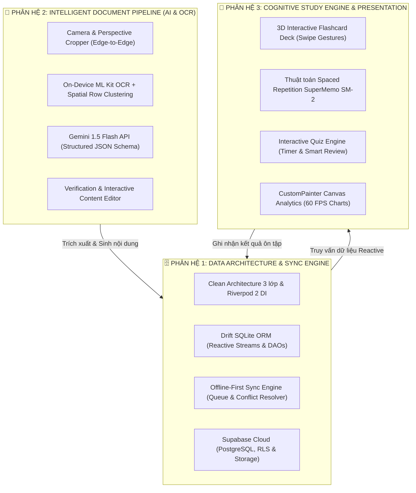

# ĐỒ ÁN CAPSTONE: NOTEFLOW AI
## Smart Study Notes & Personalized Revision (Flutter & Dart 3)

> **Học phần:** Phát triển Ứng dụng Di động Đa nền tảng (Cross-Platform Mobile App Development)  
> **Khoa:** Khoa Khoa học Máy tính — Đại học Công nghệ Thông tin và Truyền thông Việt - Hàn (VKU)  
> **Giảng viên hướng dẫn:** TS. Nguyễn Thanh Tuấn  
> **Quy mô đồ án:** Định cỡ khối lượng kỹ thuật cho nhóm **3 kỹ sư di động (3-Person Workload)**  
> **Mục tiêu:** Xây dựng ứng dụng di động chuẩn Production, kết hợp Clean Architecture 3 lớp, On-Device AI (Google ML Kit), Cloud Generative AI (Gemini API), Offline-First Data Sync (Drift SQLite $\leftrightarrow$ Supabase PostgreSQL), và thuật toán khoa học nhận thức SuperMemo SM-2.

---

## 1. TỔNG QUAN HỆ THỐNG & ĐỊNH CỠ ĐỘ PHỨC TẠP (PROJECT SIZING)

### 1.1. Bối cảnh & Bài toán thực tế
Sinh viên đại học thường xuyên tiếp cận khối lượng kiến thức khổng lồ từ nhiều nguồn phi cấu trúc: slide bài giảng PDF, ảnh chụp bảng viết, giáo trình in ấn và tài liệu tham khảo. Việc tự đọc lại, tóm tắt và tự soạn câu hỏi ôn tập thủ công tiêu tốn rất nhiều thời gian, trong khi việc ghi nhớ thường không bền vững do thiếu lộ trình ôn tập có tính khoa học.

### 1.2. Định cỡ độ phức tạp (Quy mô chuẩn 3 người làm)
Khác với các Mini-Project chỉ tập trung vào một kỹ thuật đơn lẻ (Mini 1: PWA Service Worker; Mini 2: React Native Booking; Mini 3: Flutter Expense OCR), Đồ án Capstone **NoteFlow AI** được thiết kế như một **hệ sinh thái học tập hoàn chỉnh khép kín** bao gồm 3 phân hệ kỹ thuật lớn:



---

## 2. PHÂN RÃ KHỐI LƯỢNG KỸ THUẬT CHO 3 PHÂN HỆ (3 CORE PILLARS)

Để đảm bảo quy mô 3 người làm có sự cân bằng về khối lượng và chiều sâu công nghệ, dự án được module hóa độc lập:

### 🧩 Phân hệ 1: Kiến trúc dữ liệu, Local Storage & Động cơ đồng bộ Offline-First
* **Trọng tâm kỹ thuật:** Data Layer, Database ORM, Network Interceptors, Synchronization Algorithm.
* **Các thành phần cụ thể:**
  1. **Clean Architecture Framework:** Thiết lập khung kiến trúc 3 lớp nghiêm ngặt (Domain, Data, Presentation). Toàn bộ dependency injection được quản lý bằng **Riverpod 2 (AsyncNotifier / Code Generator)**.
  2. **Drift SQLite Local Database:**
     - Thiết lập Drift ORM với kiểu dữ liệu an toàn (Type-safe SQL), viết các DAOs (Data Access Objects) chuyên biệt cho từng thực thể.
     - Triển khai Reactive Streams (`watchAllSubjects()`, `watchStudySets()`) để UI tự động cập nhật ngay khi database thay đổi mà không cần gọi setState thủ công.
     - Cấu hình Schema Migrations an toàn cho các phiên bản dữ liệu.
  3. **Động cơ đồng bộ hai chiều (Bidirectional Offline-First Sync Engine):**
     - Bảng `sync_queue` ghi nhận mọi thao tác thêm/sửa/xóa khi thiết bị ngoại tuyến.
     - Cơ chế **Tombstone Soft-Delete** (`is_deleted = true`) và cờ theo dõi phiên bản (`updated_at`).
     - Thuật toán giải quyết xung đột **Last-Write-Wins (LWW)** và chiến lược giải quyết xung đột thông minh khi người dùng thay đổi dữ liệu trên nhiều thiết bị.
  4. **Supabase Cloud BaaS:**
     - Khởi tạo Database PostgreSQL trên Supabase, đồng bộ cấu trúc với Drift SQLite.
     - Thiết lập chính sách bảo mật cấp hàng **Row-Level Security (RLS)** để người dùng chỉ truy cập được tài liệu của chính mình.
     - Tích hợp Supabase Storage lưu trữ file tài liệu PDF gốc.

---

### 🧩 Phân hệ 2: AI Pipeline (On-Device OCR & Cloud Generative AI)
* **Trọng tâm kỹ thuật:** Computer Vision on-device, Prompt Engineering, Structured LLM Outputs, Content Validation.
* **Các thành phần cụ thể:**
  1. **Document Ingestion & Image Cropping:**
     - Tích hợp `image_picker` và `image_cropper` (`UCropActivity`).
     - Tối ưu hiển thị thanh công cụ cắt ảnh tránh tai thỏ (`fitsSystemWindows: true`, `statusBarLight: false`).
     - Nén ảnh thông minh trước khi đưa vào pipeline để tiết kiệm bộ nhớ RAM.
  2. **On-Device OCR với Spatial Row Clustering:**
     - Sử dụng `google_mlkit_text_recognition` chạy 100% offline với độ trễ <100ms.
     - Thuật toán **Spatial Row Clustering** dựa trên tọa độ hình học `boundingBox` để ghép nối chính xác các cột và hàng văn bản trên tài liệu đa cột, khắc phục nhược điểm nhận diện rời rạc của ML Kit.
  3. **Google Gemini 1.5 Flash API Client:**
     - Xây dựng lớp giao tiếp API với cấu hình kiểm soát chặt chẽ: Timeout, Exponential Backoff Retry khi mạng chập chờn.
     - **Structured Outputs (JSON Schema Enforcement):** Ép buộc LLM trả về cấu trúc JSON nghiêm ngặt gồm 3 phần:
       + `summary`: Chuỗi định dạng Markdown tóm tắt các luận điểm cốt lõi.
       + `flashcards`: Mảng các đối tượng `{ front, back, hint }`.
       + `quiz`: Mảng các đối tượng `{ question, options, correct_index, explanation }`.
  4. **Verification & Content Editor UI:**
     - Màn hình xem lại văn bản OCR trước khi gửi cho AI.
     - Màn hình chỉnh sửa/duyệt nội dung tóm tắt, thẻ flashcard và câu hỏi trắc nghiệm trước khi commit lưu trữ vào cơ sở dữ liệu.

---

### 🧩 Phân hệ 3: Cognitive Study Engine, Gamification & Data Visualization
* **Trọng tâm kỹ thuật:** Cognitive Science Algorithms, 3D Canvas Rendering, Animation Performance 60 FPS, Interactive Gestures.
* **Các thành phần cụ thể:**
  1. **Interactive Flashcard Deck:**
     - Thiết kế giao diện lật thẻ 3 chiều (3D Flip Animation) sử dụng ma trận biến đổi `Matrix4` mượt mà.
     - Hỗ trợ cử chỉ vuốt thẻ tương tác (Swipe Gestures) theo 3 mức độ đánh giá: *Khó (Again/Hard)*, *Vừa (Good)*, *Dễ (Easy)*.
  2. **Thuật toán lặp lại ngắt quãng SuperMemo SM-2 (SRS Engine):**
     - Hiện thực hóa thuật toán khoa học nhận thức SM-2 trong Domain Layer:
       $$\text{EF}' = \text{EF} + \left(0.1 - (5 - q) \times (0.08 + (5 - q) \times 0.02)\right)$$
       $$\text{Interval}(n) = \begin{cases} 
       1 \text{ ngày} & \text{khi } n = 1 \\ 
       6 \text{ ngày} & \text{khi } n = 2 \\ 
       \text{Interval}(n - 1) \times \text{EF}' & \text{khi } n > 2 
       \end{cases}$$
     - Tự động lên lịch ngày ôn tập tiếp theo (`next_review_at`) cho từng thẻ nhớ, đưa các thẻ hay quên vào danh sách ưu tiên ôn tập hàng ngày.
  3. **Quiz Challenge Engine:**
     - Chế độ thi trắc nghiệm bấm giờ: Hiển thị bộ câu hỏi ngẫu nhiên, thanh tiến trình đếm ngược thời gian làm bài.
     - Chấm điểm tức thì, thống kê câu đúng/sai kèm lời giải thích chi tiết.
     - Lưu trữ kết quả phiên học vào bảng `study_sessions`.
  4. **Custom Canvas Visualizations (`CustomPainter` 60 FPS):**
     - **Retention Curve Painter:** Vẽ đường cong ghi nhớ kiến thức theo thời gian thực.
     - **Subject Donut Painter:** Biểu đồ tròn phân bổ thời gian học tập giữa các môn học có animation xoay và tap xem chi tiết.
     - **Weekly Activity Bar Painter:** Biểu đồ cột thể hiện số lượng thẻ và câu hỏi đã hoàn thành trong 7 ngày gần nhất.
     - *Cam kết:* 100% vẽ trực tiếp trên `Canvas` bằng `CustomPainter`, không dùng thư viện ngoài.
  5. **Material 3 Design System & Responsive Layout:**
     - Đồng bộ Dark Mode và Light Mode với bảng màu chuẩn học tập cao cấp (`#0284C7`, `#0F172A`).
     - Bố cục thích ứng (Responsive) hiển thị mượt mà trên cả điện thoại màn hình dọc và máy tính bảng xoay ngang (LayoutBuilder/Expanded).

---

## 3. THIẾT KẾ CƠ SỞ DỮ LIỆU CHI TIẾT (SCHEMA DESIGN)

### 3.1. Mô hình thực thể quan hệ (ERD)

```text
SUBJECTS (Môn học)
  ├── id: UUID (PK)
  ├── title: TEXT
  ├── code: TEXT (Mã môn: IT001...)
  ├── color_hex: TEXT
  ├── updated_at: TIMESTAMP
  └── is_deleted: BOOLEAN

DOCUMENTS (Tài liệu học tập)
  ├── id: UUID (PK)
  ├── subject_id: UUID (FK -> SUBJECTS.id)
  ├── title: TEXT
  ├── file_type: TEXT (IMAGE / PDF / TEXT)
  ├── local_file_path: TEXT
  ├── raw_extracted_text: TEXT
  ├── updated_at: TIMESTAMP
  └── is_deleted: BOOLEAN

STUDY_SETS (Bộ nội dung học tập được AI sinh ra)
  ├── id: UUID (PK)
  ├── document_id: UUID (FK -> DOCUMENTS.id)
  ├── title: TEXT
  ├── summary_markdown: TEXT
  ├── updated_at: TIMESTAMP
  └── is_deleted: BOOLEAN

FLASHCARDS (Thẻ ghi nhớ)
  ├── id: UUID (PK)
  ├── study_set_id: UUID (FK -> STUDY_SETS.id)
  ├── front_text: TEXT
  ├── back_text: TEXT
  ├── hint: TEXT?
  ├── ease_factor: REAL (Mặc định 2.5)
  ├── interval_days: INTEGER (Mặc định 0)
  ├── repetition_count: INTEGER (Mặc định 0)
  ├── next_review_at: TIMESTAMP
  ├── updated_at: TIMESTAMP
  └── is_deleted: BOOLEAN

QUIZ_QUESTIONS (Câu hỏi trắc nghiệm)
  ├── id: UUID (PK)
  ├── study_set_id: UUID (FK -> STUDY_SETS.id)
  ├── question_text: TEXT
  ├── options_json: TEXT (Mảng 4 đáp án dạng JSON)
  ├── correct_index: INTEGER (0 - 3)
  ├── explanation: TEXT
  ├── times_answered: INTEGER
  ├── times_correct: INTEGER
  ├── updated_at: TIMESTAMP
  └── is_deleted: BOOLEAN

STUDY_SESSIONS (Lịch sử ôn tập)
  ├── id: UUID (PK)
  ├── study_set_id: UUID (FK -> STUDY_SETS.id)
  ├── session_type: TEXT (FLASHCARD / QUIZ)
  ├── score: REAL?
  ├── total_items: INTEGER
  ├── duration_seconds: INTEGER
  └── completed_at: TIMESTAMP

SYNC_QUEUE (Hàng đợi đồng bộ Offline-First)
  ├── id: UUID (PK)
  ├── table_name: TEXT
  ├── record_id: UUID
  ├── operation: TEXT (INSERT / UPDATE / DELETE)
  ├── payload_json: TEXT
  ├── status: TEXT (PENDING / SYNCING / FAILED)
  ├── retry_count: INTEGER
  └── created_at: TIMESTAMP
```

---

## 4. KẾ HOẠCH TRIỂN KHAI & TIẾN ĐỘ THEO SPRINT (ROADMAP)

Dự án được triển khai trong **5 giai đoạn (Phases / Sprints)**:

| Giai đoạn | Mục tiêu chính | Đầu ra kiểm thử (Deliverables) |
| :--- | :--- | :--- |
| **Phase 1: Nền tảng kiến trúc & Quản lý tài liệu** | • Setup Flutter project với Clean Architecture 3 lớp nghiêm ngặt<br/>• Cấu hình Riverpod 2 (AsyncNotifier) & Drift SQLite ORM<br/>• Quản lý danh sách Môn học & Tài liệu học tập (CRUD hoàn chỉnh) | Ứng dụng chạy mượt trên thiết bị, thêm/sửa/xóa môn học và tài liệu lưu trữ vào SQLite cục bộ bền vững. |
| **Phase 2: On-Device OCR & Gemini AI Pipeline** | • Tích hợp Google ML Kit OCR chạy offline sub-100ms<br/>• Thuật toán gom dòng không gian Spatial Row Clustering<br/>• Tích hợp Gemini 1.5 Flash API với Structured JSON Output<br/>• Màn hình Review, xem trước và chỉnh sửa kết quả sinh AI | Quét ảnh chụp bài giảng thực tế $\rightarrow$ OCR thành công offline $\rightarrow$ gửi Gemini sinh bản tóm tắt, 10 flashcard, 5 câu trắc nghiệm chuẩn JSON. |
| **Phase 3: Interactive Study Engine & Visuals** | • Lập trình thẻ Flashcard lật 3D kèm vuốt cử chỉ Swipe<br/>• Tích hợp thuật toán lặp lại ngắt quãng SuperMemo SM-2<br/>• Lập trình Quiz trắc nghiệm bấm giờ, chấm điểm và xem lời giải<br/>• Vẽ 2 biểu đồ CustomPainter (Retention Curve & Weekly Activity) | Người học có thể lật thẻ, chấm điểm thẻ nhớ theo thuật toán SM-2, làm đề thi thử và quan sát biểu đồ tiến độ học tập vẽ thuần trên Canvas. |
| **Phase 4: Cloud BaaS & Offline-First Sync** | • Tích hợp Supabase Auth (Đăng nhập sinh viên)<br/>• Thiết kế PostgreSQL Schema & Row-Level Security (RLS)<br/>• Xây dựng Sync Queue đồng bộ 2 chiều (Drift $\leftrightarrow$ Supabase)<br/>• Thuật toán giải quyết xung đột Last-Write-Wins (LWW) | Tắt Wi-Fi $\rightarrow$ thao tác tạo tài liệu và học bài $\rightarrow$ bật Wi-Fi $\rightarrow$ hệ thống tự động đẩy dữ liệu lên Supabase không bị mất mát hay xung đột. |
| **Phase 5: Kiểm thử, Tối ưu & Đóng gói Release** | • Viết Unit Test cho thuật toán SM-2 và Use Cases (>70% coverage)<br/>• Tối ưu bộ nhớ đệm ảnh (`cacheWidth/cacheHeight`) đạt 60 FPS<br/>• Cấu hình Fastlane & GitHub Actions tự động build APK<br/>• Biên soạn Báo cáo kỹ thuật PDF (VKU Template), Slide & Video Demo | Bản `app-release.apk` ký số hoàn chỉnh, video demo 3 phút, báo cáo kỹ thuật 4 trang đạt chuẩn rubric 10 điểm. |

---

## 5. BỘ TIÊU CHÍ CHẤM ĐIỂM DỰ KIẾN (RUBRIC ĐÁNH GIÁ 10 ĐIỂM)

| Thành phần đánh giá | Nội dung yêu cầu kỹ thuật | Trọng số điểm |
| :--- | :--- | :---: |
| **1. Kiến trúc phần mềm & State Management** | Clean Architecture 3 lớp nghiêm ngặt, ranh giới Domain tách biệt hoàn toàn; Riverpod 2 quản lý state mượt mà, không phụ thuộc UI; Drift SQLite ORM type-safe. | **2.0 điểm** |
| **2. Xử lý AI on-device & Cloud Generative AI** | Google ML Kit OCR chạy offline sub-100ms kèm Spatial Clustering gom dòng đa cột; Gemini 1.5 Flash API sinh cấu trúc JSON chuẩn (Summary, Flashcards, Quiz); xử lý timeout/retry mượt mà. | **2.5 điểm** |
| **3. Động cơ học tập (Study Engine) & Khoa học nhận thức** | Hiện thực hóa chính xác thuật toán SuperMemo SM-2; thẻ flashcard lật 3D animation; quiz trắc nghiệm đếm giờ, chấm điểm tức thì; lưu lịch sử phiên học. | **2.0 điểm** |
| **4. Cơ chế đồng bộ Offline-First & Cloud Security** | Sử dụng bình thường khi ngắt mạng; tự động đồng bộ khi có Internet qua Sync Queue; xử lý xung đột dữ liệu; Supabase PostgreSQL được bảo vệ nghiêm ngặt qua RLS Policies. | **1.5 điểm** |
| **5. Đồ họa Canvas thuần & UI/UX Polish** | Vẽ biểu đồ tiến độ học tập bằng `CustomPainter` thuần (không dùng thư viện ngoài); Material 3 chuẩn chỉnh, Dark Mode & Light Mode; responsive tablet/mobile; tối ưu 60 FPS. | **1.0 điểm** |
| **6. Sản phẩm bàn giao & Báo cáo kỹ thuật** | File ký số `app-release.apk` cài đặt trực tiếp; kho mã nguồn GitHub sạch sẽ; video demo 3 phút; báo cáo kỹ thuật PDF chuẩn mẫu VKU. | **1.0 điểm** |
| **TỔNG CỘNG** | | **10.0 điểm** |

---

## 6. DANH MỤC CÔNG NGHỆ & THƯ VIỆN CHÍNH THỨC (DEPENDENCIES)

```yaml
name: noteflow_ai
description: Smart Study Notes & Personalized Revision (Flutter, ML Kit, Gemini, Drift, Supabase)
version: 1.0.0+1

environment:
  sdk: '>=3.3.0 <4.0.0'

dependencies:
  flutter:
    sdk: flutter

  # State Management & Dependency Injection
  flutter_riverpod: ^2.5.1
  riverpod_annotation: ^2.3.5

  # Local Database (Type-Safe SQLite ORM)
  drift: ^2.18.0
  sqlite3_flutter_libs: ^0.5.24
  path_provider: ^2.1.3
  path: ^1.9.0

  # Cloud BaaS & Network
  supabase_flutter: ^2.5.4
  dio: ^5.4.3+1
  connectivity_plus: ^6.0.3

  # On-Device AI & Media Processing
  google_mlkit_text_recognition: ^0.13.1
  image_picker: ^1.1.2
  image_cropper: ^8.0.2

  # Generative AI (Cloud)
  google_generative_ai: ^0.4.0

  # UI / Markdown & Utilities
  flutter_markdown: ^0.7.1
  uuid: ^4.4.0
  intl: ^0.19.0

dev_dependencies:
  flutter_test:
    sdk: flutter
  flutter_lints: ^4.0.0
  build_runner: ^2.4.9
  drift_dev: ^2.18.0
  riverpod_generator: ^2.4.0
```

---

*Tài liệu đặc tả này là kim chỉ nam kiến trúc và lộ trình thực thi chính thức cho Đồ án Capstone NoteFlow AI.*

---

### 🧩 Phân hệ 3: Cognitive Study Engine, Gamification & Data Visualization
* **Trọng tâm kỹ thuật:** Cognitive Science Algorithms, 3D Canvas Rendering, Animation Performance 60 FPS, Interactive Gestures.
* **Các thành phần cụ thể:**
  1. **Interactive Flashcard Deck:**
     - Thiết kế giao diện lật thẻ 3 chiều (3D Flip Animation) sử dụng ma trận biến đổi `Matrix4` mượt mà.
     - Hỗ trợ cử chỉ vuốt thẻ tương tác (Swipe Gestures) theo 3 mức độ đánh giá: *Khó (Again/Hard)*, *Vừa (Good)*, *Dễ (Easy)*.
  2. **Thuật toán lặp lại ngắt quãng SuperMemo SM-2 (SRS Engine):**
     - Hiện thực hóa thuật toán khoa học nhận thức SM-2 trong Domain Layer:
       $$\text{EF}' = \text{EF} + \left(0.1 - (5 - q) \times (0.08 + (5 - q) \times 0.02)\right)$$
       $$\text{Interval}(n) = \begin{cases} 
       1 \text{ ngày} & \text{khi } n = 1 \\ 
       6 \text{ ngày} & \text{khi } n = 2 \\ 
       \text{Interval}(n - 1) \times \text{EF}' & \text{khi } n > 2 
       \end{cases}$$
     - Tự động lên lịch ngày ôn tập tiếp theo (`next_review_at`) cho từng thẻ nhớ, đưa các thẻ hay quên vào danh sách ưu tiên ôn tập hàng ngày.
  3. **Quiz Challenge Engine:**
     - Chế độ thi trắc nghiệm bấm giờ: Hiển thị bộ câu hỏi ngẫu nhiên, thanh tiến trình đếm ngược thời gian làm bài.
     - Chấm điểm tức thì, thống kê câu đúng/sai kèm lời giải thích chi tiết.
     - Lưu trữ kết quả phiên học vào bảng `study_sessions`.
  4. **Custom Canvas Visualizations (`CustomPainter` 60 FPS):**
     - **Retention Curve Painter:** Vẽ đường cong ghi nhớ kiến thức theo thời gian thực.
     - **Subject Donut Painter:** Biểu đồ tròn phân bổ thời gian học tập giữa các môn học có animation xoay và tap xem chi tiết.
     - **Weekly Activity Bar Painter:** Biểu đồ cột thể hiện số lượng thẻ và câu hỏi đã hoàn thành trong 7 ngày gần nhất.
     - *Cam kết:* 100% vẽ trực tiếp trên `Canvas` bằng `CustomPainter`, không dùng thư viện ngoài.
  5. **Material 3 Design System & Responsive Layout:**
     - Đồng bộ Dark Mode và Light Mode với bảng màu chuẩn học tập cao cấp (`#0284C7`, `#0F172A`).
     - Bố cục thích ứng (Responsive) hiển thị mượt mà trên cả điện thoại màn hình dọc và máy tính bảng xoay ngang (LayoutBuilder/Expanded).

---

## 3. THIẾT KẾ CƠ SỞ DỮ LIỆU CHI TIẾT (SCHEMA DESIGN)

### 3.1. Mô hình thực thể quan hệ (ERD)

```text
SUBJECTS (Môn học)
  ├── id: UUID (PK)
  ├── title: TEXT
  ├── code: TEXT (Mã môn: IT001...)
  ├── color_hex: TEXT
  ├── updated_at: TIMESTAMP
  └── is_deleted: BOOLEAN

DOCUMENTS (Tài liệu học tập)
  ├── id: UUID (PK)
  ├── subject_id: UUID (FK -> SUBJECTS.id)
  ├── title: TEXT
  ├── file_type: TEXT (IMAGE / PDF / TEXT)
  ├── local_file_path: TEXT
  ├── raw_extracted_text: TEXT
  ├── updated_at: TIMESTAMP
  └── is_deleted: BOOLEAN

STUDY_SETS (Bộ nội dung học tập được AI sinh ra)
  ├── id: UUID (PK)
  ├── document_id: UUID (FK -> DOCUMENTS.id)
  ├── title: TEXT
  ├── summary_markdown: TEXT
  ├── updated_at: TIMESTAMP
  └── is_deleted: BOOLEAN

FLASHCARDS (Thẻ ghi nhớ)
  ├── id: UUID (PK)
  ├── study_set_id: UUID (FK -> STUDY_SETS.id)
  ├── front_text: TEXT
  ├── back_text: TEXT
  ├── hint: TEXT?
  ├── ease_factor: REAL (Mặc định 2.5)
  ├── interval_days: INTEGER (Mặc định 0)
  ├── repetition_count: INTEGER (Mặc định 0)
  ├── next_review_at: TIMESTAMP
  ├── updated_at: TIMESTAMP
  └── is_deleted: BOOLEAN

QUIZ_QUESTIONS (Câu hỏi trắc nghiệm)
  ├── id: UUID (PK)
  ├── study_set_id: UUID (FK -> STUDY_SETS.id)
  ├── question_text: TEXT
  ├── options_json: TEXT (Mảng 4 đáp án dạng JSON)
  ├── correct_index: INTEGER (0 - 3)
  ├── explanation: TEXT
  ├── times_answered: INTEGER
  ├── times_correct: INTEGER
  ├── updated_at: TIMESTAMP
  └── is_deleted: BOOLEAN

STUDY_SESSIONS (Lịch sử ôn tập)
  ├── id: UUID (PK)
  ├── study_set_id: UUID (FK -> STUDY_SETS.id)
  ├── session_type: TEXT (FLASHCARD / QUIZ)
  ├── score: REAL?
  ├── total_items: INTEGER
  ├── duration_seconds: INTEGER
  └── completed_at: TIMESTAMP

SYNC_QUEUE (Hàng đợi đồng bộ Offline-First)
  ├── id: UUID (PK)
  ├── table_name: TEXT
  ├── record_id: UUID
  ├── operation: TEXT (INSERT / UPDATE / DELETE)
  ├── payload_json: TEXT
  ├── status: TEXT (PENDING / SYNCING / FAILED)
  ├── retry_count: INTEGER
  └── created_at: TIMESTAMP
```

---

## 4. KẾ HOẠCH TRIỂN KHAI & TIẾN ĐỘ THEO SPRINT (ROADMAP)

Dự án được triển khai trong **5 giai đoạn (Phases / Sprints)**:

| Giai đoạn | Mục tiêu chính | Đầu ra kiểm thử (Deliverables) |
| :--- | :--- | :--- |
| **Phase 1: Nền tảng kiến trúc & Quản lý tài liệu** | • Setup Flutter project với Clean Architecture 3 lớp nghiêm ngặt<br/>• Cấu hình Riverpod 2 (AsyncNotifier) & Drift SQLite ORM<br/>• Quản lý danh sách Môn học & Tài liệu học tập (CRUD hoàn chỉnh) | Ứng dụng chạy mượt trên thiết bị, thêm/sửa/xóa môn học và tài liệu lưu trữ vào SQLite cục bộ bền vững. |
| **Phase 2: On-Device OCR & Gemini AI Pipeline** | • Tích hợp Google ML Kit OCR chạy offline sub-100ms<br/>• Thuật toán gom dòng không gian Spatial Row Clustering<br/>• Tích hợp Gemini 1.5 Flash API với Structured JSON Output<br/>• Màn hình Review, xem trước và chỉnh sửa kết quả sinh AI | Quét ảnh chụp bài giảng thực tế $\rightarrow$ OCR thành công offline $\rightarrow$ gửi Gemini sinh bản tóm tắt, 10 flashcard, 5 câu trắc nghiệm chuẩn JSON. |
| **Phase 3: Interactive Study Engine & Visuals** | • Lập trình thẻ Flashcard lật 3D kèm vuốt cử chỉ Swipe<br/>• Tích hợp thuật toán lặp lại ngắt quãng SuperMemo SM-2<br/>• Lập trình Quiz trắc nghiệm bấm giờ, chấm điểm và xem lời giải<br/>• Vẽ 2 biểu đồ CustomPainter (Retention Curve & Weekly Activity) | Người học có thể lật thẻ, chấm điểm thẻ nhớ theo thuật toán SM-2, làm đề thi thử và quan sát biểu đồ tiến độ học tập vẽ thuần trên Canvas. |
| **Phase 4: Cloud BaaS & Offline-First Sync** | • Tích hợp Supabase Auth (Đăng nhập sinh viên)<br/>• Thiết kế PostgreSQL Schema & Row-Level Security (RLS)<br/>• Xây dựng Sync Queue đồng bộ 2 chiều (Drift $\leftrightarrow$ Supabase)<br/>• Thuật toán giải quyết xung đột Last-Write-Wins (LWW) | Tắt Wi-Fi $\rightarrow$ thao tác tạo tài liệu và học bài $\rightarrow$ bật Wi-Fi $\rightarrow$ hệ thống tự động đẩy dữ liệu lên Supabase không bị mất mát hay xung đột. |
| **Phase 5: Kiểm thử, Tối ưu & Đóng gói Release** | • Viết Unit Test cho thuật toán SM-2 và Use Cases (>70% coverage)<br/>• Tối ưu bộ nhớ đệm ảnh (`cacheWidth/cacheHeight`) đạt 60 FPS<br/>• Cấu hình Fastlane & GitHub Actions tự động build APK<br/>• Biên soạn Báo cáo kỹ thuật PDF (VKU Template), Slide & Video Demo | Bản `app-release.apk` ký số hoàn chỉnh, video demo 3 phút, báo cáo kỹ thuật 4 trang đạt chuẩn rubric 10 điểm. |

---

## 5. BỘ TIÊU CHÍ CHẤM ĐIỂM DỰ KIẾN (RUBRIC ĐÁNH GIÁ 10 ĐIỂM)

| Thành phần đánh giá | Nội dung yêu cầu kỹ thuật | Trọng số điểm |
| :--- | :--- | :---: |
| **1. Kiến trúc phần mềm & State Management** | Clean Architecture 3 lớp nghiêm ngặt, ranh giới Domain tách biệt hoàn toàn; Riverpod 2 quản lý state mượt mà, không phụ thuộc UI; Drift SQLite ORM type-safe. | **2.0 điểm** |
| **2. Xử lý AI on-device & Cloud Generative AI** | Google ML Kit OCR chạy offline sub-100ms kèm Spatial Clustering gom dòng đa cột; Gemini 1.5 Flash API sinh cấu trúc JSON chuẩn (Summary, Flashcards, Quiz); xử lý timeout/retry mượt mà. | **2.5 điểm** |
| **3. Động cơ học tập (Study Engine) & Khoa học nhận thức** | Hiện thực hóa chính xác thuật toán SuperMemo SM-2; thẻ flashcard lật 3D animation; quiz trắc nghiệm đếm giờ, chấm điểm tức thì; lưu lịch sử phiên học. | **2.0 điểm** |
| **4. Cơ chế đồng bộ Offline-First & Cloud Security** | Sử dụng bình thường khi ngắt mạng; tự động đồng bộ khi có Internet qua Sync Queue; xử lý xung đột dữ liệu; Supabase PostgreSQL được bảo vệ nghiêm ngặt qua RLS Policies. | **1.5 điểm** |
| **5. Đồ họa Canvas thuần & UI/UX Polish** | Vẽ biểu đồ tiến độ học tập bằng `CustomPainter` thuần (không dùng thư viện ngoài); Material 3 chuẩn chỉnh, Dark Mode & Light Mode; responsive tablet/mobile; tối ưu 60 FPS. | **1.0 điểm** |
| **6. Sản phẩm bàn giao & Báo cáo kỹ thuật** | File ký số `app-release.apk` cài đặt trực tiếp; kho mã nguồn GitHub sạch sẽ; video demo 3 phút; báo cáo kỹ thuật PDF chuẩn mẫu VKU. | **1.0 điểm** |
| **TỔNG CỘNG** | | **10.0 điểm** |

---

## 6. DANH MỤC CÔNG NGHỆ & THƯ VIỆN CHÍNH THỨC (DEPENDENCIES)

```yaml
name: noteflow_ai
description: Smart Study Notes & Personalized Revision (Flutter, ML Kit, Gemini, Drift, Supabase)
version: 1.0.0+1

environment:
  sdk: '>=3.3.0 <4.0.0'

dependencies:
  flutter:
    sdk: flutter

  # State Management & Dependency Injection
  flutter_riverpod: ^2.5.1
  riverpod_annotation: ^2.3.5

  # Local Database (Type-Safe SQLite ORM)
  drift: ^2.18.0
  sqlite3_flutter_libs: ^0.5.24
  path_provider: ^2.1.3
  path: ^1.9.0

  # Cloud BaaS & Network
  supabase_flutter: ^2.5.4
  dio: ^5.4.3+1
  connectivity_plus: ^6.0.3

  # On-Device AI & Media Processing
  google_mlkit_text_recognition: ^0.13.1
  image_picker: ^1.1.2
  image_cropper: ^8.0.2

  # Generative AI (Cloud)
  google_generative_ai: ^0.4.0

  # UI / Markdown & Utilities
  flutter_markdown: ^0.7.1
  uuid: ^4.4.0
  intl: ^0.19.0

dev_dependencies:
  flutter_test:
    sdk: flutter
  flutter_lints: ^4.0.0
  build_runner: ^2.4.9
  drift_dev: ^2.18.0
  riverpod_generator: ^2.4.0
```

---

*Tài liệu đặc tả này là kim chỉ nam kiến trúc và lộ trình thực thi chính thức cho Đồ án Capstone NoteFlow AI.*

