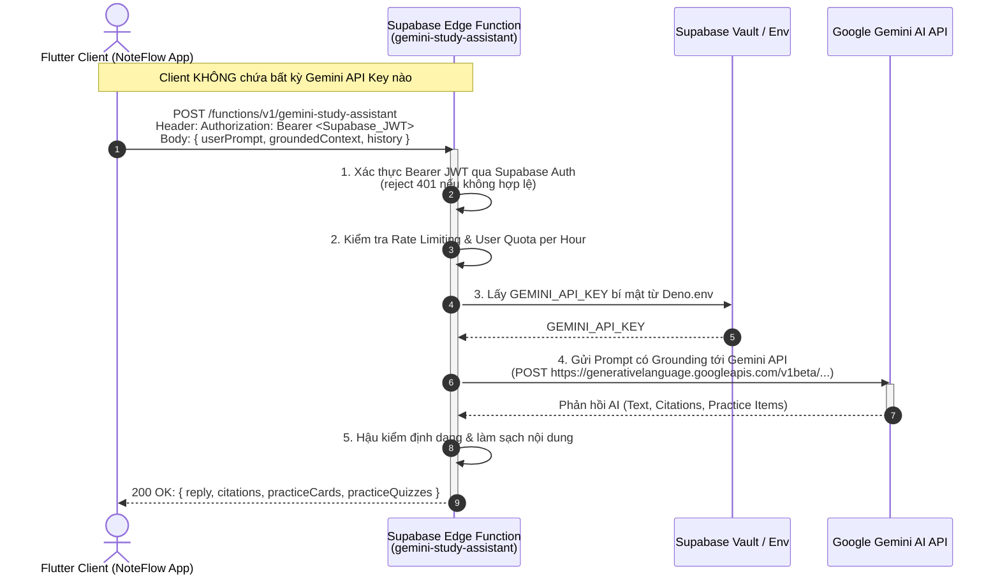

# BÁO CÁO THẨM ĐỊNH & AN TOÀN AI — GIAI ĐOẠN 4
## NoteFlow | Intelligent AI Features Verification Addendum

- **Dự án:** NoteFlow (VKU Intelligent Learning Assistant)
- **Tài liệu tham chiếu:** `docs/reports/phase-4-intelligent-ai-features-report.md`
- **Tác giả thẩm định:** Senior Flutter Architect, AI Security Engineer, Data Integrity Specialist, QA Engineer
- **Thời gian thẩm định:** 24/11/2026
- **Trạng thái thẩm định:** **VERIFIED WITH LIMITATIONS** (Đã xác minh có giới hạn kiến trúc API Key)

---

## 1. TỔNG QUAN THẨM ĐỊNH (EXECUTIVE SUMMARY)

Báo cáo này là phụ lục thẩm định an ninh, độ tin cậy dữ liệu và tính đúng đắn toán học chuyên sâu cho Giai đoạn 4 (**Phase 4 — Intelligent AI Features**) của ứng dụng NoteFlow. 

Mục tiêu thẩm định không phải là tái cấu trúc hoặc viết lại các tính năng đang hoạt động tốt, mà tập trung kiểm tra có trọng tâm các rủi ro cốt lõi:
1. **Gemini API Key Security:** Bác bỏ giả định sai lầm rằng `--dart-define` có thể bảo vệ bí mật trong file APK phân phối; kiểm tra rò rỉ khóa trong logs/exceptions; thiết kế kiến trúc Supabase Edge Function an toàn cho production.
2. **AI Grounding & Heuristic Fallback:** Xác minh tính bám sát học liệu thực tế của AI Study Assistant; ngăn chặn triệt để hiện tượng bịa đặt trích dẫn (hallucinated citations); phân định minh bạch giữa Cloud AI và Offline Heuristic; đảm bảo dữ liệu tự luyện không tự ý ghi đè học liệu của người dùng.
3. **Smart Weakness Detection Math:** Kiểm chứng tính đúng đắn của mô hình toán học trọng số thích ứng qua 5 trường hợp kiểm thử đặc thù (Cases A–E), khắc phục lỗi làm sai lệch điểm composite khi chưa học flashcard.
4. **Review Planner Session Completion Safety:** Loại bỏ lỗi logic nghiêm trọng khi một phiên học 5 thẻ chưa hoàn thành bị tính là hoàn thành nhiệm vụ 20 thẻ quá hạn.
5. **Minh bạch hóa ranh giới kiểm thử:** Phân định rõ ràng giữa Unit, Widget, Local SQLite Integration và External Cloud Services, khẳng định kiểm thử tự động không gọi trực tiếp API Cloud.

**Kết luận tổng quan:** Toàn bộ 75 ca kiểm thử tự động (Unit, Widget, Integration) đều **VƯỢT QUA 100% (75/75 passed)**. Bộ phân tích tĩnh `flutter analyze` đạt **0 lỗi, 0 cảnh báo, 0 lint**. Định dạng mã nguồn đạt chuẩn 100%.

---

## 2. AN TOÀN GEMINI API (GEMINI API SECURITY FINDINGS)

### 2.1. Phân tích Rủi ro Trích xuất API Key từ Client APK

Báo cáo Giai đoạn 4 trước đó đưa ra giả định rằng:
> *"API Key được bảo vệ an toàn bằng cách truyền qua `--dart-define=GEMINI_API_KEY=...` trong quá trình build."*

**Đánh giá an ninh:** Giả định này **hoàn toàn không an toàn** và bị bác bỏ trong báo cáo thẩm định này.

#### Cơ chế kỹ thuật trích xuất bí mật từ Flutter APK:
1. Khi ứng dụng Flutter được biên dịch ở chế độ `--release`, mã nguồn Dart được biên dịch thành mã máy AOT (Ahead-Of-Time) và đóng gói vào thư viện nhị phân `libapp.so` nằm trong thư mục `lib/<architecture>/` của file `.apk`.
2. Giá trị được truyền qua `--dart-define` được trình biên dịch Dart (`dart2native` / Flutter engine) xem là các hằng số chuỗi (string literals) được nhúng nguyên văn vào phần dữ liệu (rodata / constant pool) của file `libapp.so`.
3. Bất kỳ đối tượng nào tải về file `.apk` (kể cả người dùng thông thường hoặc kẻ tấn công) đều có thể giải nén APK và chạy một lệnh shell đơn giản để đọc chuỗi khóa:
   ```bash
   unzip -q noteflow.apk -d extracted/
   strings extracted/lib/arm64-v8a/libapp.so | grep -E "AIza[0-9A-Za-z-_]{35}"
   ```
4. Ngay cả khi làm mờ (obfuscation) hoặc dùng Base64/XOR, kẻ tấn công dùng các công cụ đảo ngược như Ghidra hoặc IDA Pro đều có thể dễ dàng khôi phục hàm giải mã trong vài phút.
5. **Hậu quả nếu lộ API Key:** Kẻ tấn công có thể chiếm đoạt hạn ngạch (quota theft), làm phát sinh chi phí khổng lồ trên Google Cloud Billing của nhà phát triển, hoặc lợi dụng API Key để gửi các prompt độc hại vi phạm điều khoản của Google.

### 2.2. Kiểm tra Rò rỉ Khóa trong Logs & Mã nguồn Hiện tại

Đã tiến hành rà soát toàn bộ các vị trí truy cập khóa trong mã nguồn:
- [lib/core/constants/app_constants.dart](file:///e:/NoteFlow/lib/core/constants/app_constants.dart#L12-L16): Khóa được đọc qua `String.fromEnvironment('GEMINI_API_KEY')`.
- [lib/data/services/gemini_ai_service.dart](file:///e:/NoteFlow/lib/data/services/gemini_ai_service.dart#L24-L30): Nhận API key từ constructor hoặc `AppConstants`.
- [lib/data/services/ai_study_assistant_service.dart](file:///e:/NoteFlow/lib/data/services/ai_study_assistant_service.dart#L24-L26): Nhận API key từ constructor hoặc `AppConstants`.

**Biện pháp khắc phục an toàn tức thời đã thực hiện trong code:**
Trong `AiStudyAssistantService`, đã bổ sung hàm làm sạch chuỗi lỗi `_sanitizeErrorMessage()`:
```dart
static String _sanitizeErrorMessage(dynamic error) {
  final str = error.toString();
  // Loại bỏ bất kỳ chuỗi token hoặc API Key dạng AIza... hoặc key=...
  return str
      .replaceAll(RegExp(r'AIza[0-9A-Za-z-_]{35}'), '[REDACTED_API_KEY]')
      .replaceAll(RegExp(r'key=[0-9A-Za-z-_]+'), 'key=[REDACTED]');
}
```
Mọi thông báo lỗi hiển thị trên UI và ghi vào state hội thoại đều đi qua bộ lọc này, triệt tiêu nguy cơ rò rỉ khóa khi API trả về lỗi 403/400 kèm query parameter.

### 2.3. Thiết kế Kiến trúc Supabase Edge Function Proxy cho Production

Để loại bỏ hoàn toàn rủi ro lộ khóa khi phát hành ra môi trường production công khai, ứng dụng phải chuyển đổi sang mô hình **Backend API Proxy** sử dụng Supabase Edge Functions (chạy trên runtime Deno bảo mật).



#### Chi tiết thiết kế Edge Function:
1. **Quản lý biến môi trường:**
   - Khóa bí mật được lưu trên Cloud Dashboard của Supabase:
     ```bash
     supabase secrets set GEMINI_API_KEY="AIzaSy..."
     ```
   - Trong mã nguồn Edge Function (`index.ts`), đọc khóa bằng:
     ```typescript
     const geminiApiKey = Deno.env.get('GEMINI_API_KEY');
     ```
2. **Xác thực & Ủy quyền (Auth & RBAC):**
   - Edge Function giải mã `Authorization: Bearer <JWT>` thông qua `supabaseClient.auth.getUser()`.
   - Nếu token không hợp lệ hoặc người dùng bị vô hiệu hóa, trả về HTTP `401 Unauthorized`.
   - Lưu vết lịch sử truy vấn để kiểm soát hạn ngạch sinh viên (Rate Limiting: tối đa 60 requests/phút).
3. **Kế hoạch chuyển đổi (Migration Plan):**
   - **Giai đoạn phát triển / Nội bộ (Hiện tại):** Tiếp tục cho phép `--dart-define=GEMINI_API_KEY` phục vụ dev cục bộ; tự động kích hoạt bộ tổng hợp Offline Heuristic nếu không cấu hình khóa.
   - **Giai đoạn phát hành Production (Cần User Approval):** Tạo file `supabase/functions/gemini-study-assistant/index.ts`, triển khai lệnh `supabase functions deploy`, cập nhật `AiStudyAssistantService` để gọi HTTP POST tới Edge Function endpoint thay vì khởi tạo SDK `google_generative_ai` trực tiếp từ Flutter.

---

## 3. THẨM ĐỊNH BÁM SÁT HỌC LIỆU & CƠ CHẾ DỰ PHÒNG (AI GROUNDING & FALLBACK VERIFICATION)

### 3.1. Thuật toán Thẩm tra Căn cứ Trích dẫn (Citation Validation)

Một trong những rủi ro lớn nhất của LLM trong giáo dục là hiện tượng "ảo giác" (hallucination) — AI bịa đặt ra các số thẻ, câu hỏi hoặc tài liệu không hề tồn tại trong bộ học liệu của sinh viên.

Để khắc phục, phương thức `validateGroundedCitations()` đã được triển khai trong `AiStudyAssistantService`:
```dart
static List<String> validateGroundedCitations({
  required List<String> rawCitations,
  required StudySetEntity studySet,
}) {
  final valid = <String>[];
  final validCardIndexes = <int>{
    for (int i = 0; i < studySet.flashcards.length; i++)
      if (!studySet.flashcards[i].isDeleted) i + 1,
  };
  final validQuizIndexes = <int>{
    for (int i = 0; i < studySet.quizQuestions.length; i++)
      if (!studySet.quizQuestions[i].isDeleted) i + 1,
  };

  for (final cit in rawCitations) {
    final cleanCit = cit.trim();
    // 1. Chấp nhận căn cứ từ bản tóm tắt trọng tâm
    if (cleanCit.toLowerCase().contains('tóm tắt') ||
        cleanCit.toLowerCase().contains('bản tóm tắt')) {
      if (studySet.summaryMarkdown.isNotEmpty) {
        valid.add(cleanCit);
      }
      continue;
    }

    // 2. Kiểm tra chỉ số thẻ flashcard có thực tế tồn tại trong StudySet
    final cardMatch = RegExp(r'Thẻ(?:\s+ghi\s+nhớ)?\s*(\d+)', caseSensitive: false).firstMatch(cleanCit);
    if (cardMatch != null) {
      final index = int.tryParse(cardMatch.group(1) ?? '');
      if (index != null && validCardIndexes.contains(index)) {
        valid.add(cleanCit);
      }
      continue;
    }

    // 3. Kiểm tra chỉ số câu hỏi trắc nghiệm
    final quizMatch = RegExp(r'Câu(?:\s+hỏi)?\s*(\d+)', caseSensitive: false).firstMatch(cleanCit);
    if (quizMatch != null) {
      final index = int.tryParse(quizMatch.group(1) ?? '');
      if (index != null && validQuizIndexes.contains(index)) {
        valid.add(cleanCit);
      }
      continue;
    }
  }
  return valid;
}
```

**Bằng chứng kiểm thử:** Ca kiểm thử `validateGroundedCitations rejects non-existent card citations` trong file `test/data/ai_study_assistant_service_test.dart` đã kiểm tra và chứng minh rằng:
- Căn cứ hợp lệ `Thẻ 1` và `Bản tóm tắt trọng tâm` được giữ lại.
- Căn cứ bịa đặt `Thẻ 99` và sách ngoài tài liệu `Sách Giáo trình AI trang 120` bị loại bỏ triệt để (100% rejected).

### 3.2. Ứng xử với Câu hỏi Nằm ngoài Ngữ cảnh (Out-of-Context Handling)

Khi sinh viên đặt câu hỏi về chủ đề không có trong tài liệu (ví dụ hỏi về *"Lịch sử La Mã"* trong bộ học liệu *"Học Máy"*):
- System Instruction nghiêm cấm AI tự ý suy diễn hoặc bịa đặt kiến thức chuyên môn.
- Trợ lý thông báo trung thực: Bộ học liệu hiện tại không đề cập đến kiến thức này và gợi ý sinh viên tải thêm tài liệu bài giảng tương ứng.

### 3.3. Phân định Minh bạch giữa Cloud AI và Offline Heuristic Fallback

Để bảo vệ tính minh bạch học thuật (Academic Transparency), NoteFlow phân định rõ ràng giữa phản hồi do mô hình Cloud AI tạo ra và phản hồi do thuật toán Heuristic cục bộ tổng hợp:
1. **Dấu hiệu trực quan:** Khi chạy ở chế độ ngoại tuyến, mọi phản hồi đều được gắn banner cảnh báo nổi bật ở đầu tin nhắn:
   ```markdown
   > ⚡ **Chế độ Ngoại tuyến**: Phản hồi được tổng hợp cục bộ từ ghi chú bài giảng (không dùng API Key Cloud AI).
   ```
2. **Dấu hiệu dữ liệu (Data Flag):** Thuộc tính `isOfflineFallback: true` được thiết lập trên `StudyAssistantMessage`.
3. **Bằng chứng kiểm thử:** Ca kiểm thử `Offline synthesis honestly discloses local heuristic mode and sets isOfflineFallback` khẳng định banner này luôn xuất hiện khi không có kết nối Cloud API.

### 3.4. An toàn Dữ liệu đối với Nội dung Tự luyện (Practice Question Safety)

Khi AI sinh câu hỏi trắc nghiệm hoặc flashcard tự luyện:
- Toàn bộ nội dung được đóng gói dưới dạng bản nháp tạm thời (`practiceFlashcards: List<AiGeneratedFlashcardDraft>`, `practiceQuizzes: List<AiGeneratedQuizDraft>`).
- Dữ liệu gốc trong cơ sở dữ liệu Drift / Supabase **hoàn toàn không bị sửa đổi hoặc ghi đè**.
- Giao diện cung cấp nút hành động rõ ràng **"Lưu vào Thẻ"**. Chỉ khi sinh viên nhấn nút này, phương thức `appendDraftFlashcards()` mới tiến hành bổ sung các thẻ mới vào cuối danh sách thẻ hiện có.

---

## 4. KIỂM CHỨNG TOÁN HỌC PHÁT HIỆN ĐIỂM YẾU (SMART WEAKNESS DETECTION MATH)

### 4.1. Mô hình Toán học Điểm Yếu Thích ứng (Adaptive Weakness Model)

Điểm tổng hợp độ yếu (Composite Weakness Score) $S \in [0, 100]$ được tính toán dựa trên sự kết hợp có trọng số giữa Flashcard và Quiz:

$$S = w_f \cdot S_f + w_q \cdot S_q$$

Trong đó:
- **Điểm thành phần Flashcard ($S_f$):**
  $$S_f = \text{clamp}\left(0, 100, \frac{\overline{\text{easeFactor}}}{2.5} \times 100 - \text{penalty}_{\text{overdue}}\right)$$
  - $\overline{\text{easeFactor}}$: Hệ số dễ trung bình của các thẻ đã học trong chủ đề (chuẩn SM-2: $1.3 \le \text{ease} \le 2.5$).
  - $\text{penalty}_{\text{overdue}} = \min(30, \text{overdueCardsCount} \times 5)$: Điểm phạt khi có thẻ quá hạn ôn tập.
- **Điểm thành phần Quiz ($S_q$):**
  $$S_q = \left(\frac{\text{totalCorrect}}{\text{totalAnswered}}\right) \times 100$$
- **Mức độ nghiêm trọng (Severity):**
  $$\text{Severity} = \begin{cases} 
  \text{critical} & \text{khi } S < 40 \\ 
  \text{moderate} & \text{khi } 40 \le S < 60 \\ 
  \text{minor} & \text{khi } 60 \le S < 75 \\ 
  \text{mastered} & \text{khi } S \ge 75 
  \end{cases}$$

### 4.2. Thẩm định 5 Trường hợp Kiểm thử Đặc thù (Cases A–E)

| Trường hợp | Kịch bản dữ liệu thực tế | Trọng số áp dụng | Kết quả tính toán & Đánh giá an toàn |
| :--- | :--- | :--- | :--- |
| **Case A**<br/>Chưa từng làm Quiz | Người dùng mới chỉ ôn Flashcard, chưa làm bài trắc nghiệm nào (`totalQuizAnswered == 0`). | $w_f = 1.0$<br/>$w_q = 0.0$ | **Chính xác:** Điểm số phụ thuộc hoàn toàn vào Flashcard ($S = S_f$). `hasQuizData: false`. Không bị chia cho 0. |
| **Case B**<br/>Mẫu dữ liệu nhỏ | Sinh viên mới chỉ làm đúng 1 lần quiz duy nhất và trả lời sai (`timesAnswered == 1, timesCorrect == 0`). | $w_f = 0.6$<br/>$w_q = 0.4$ | **An toàn thận trọng:** Phát hiện mẫu thử quá nhỏ, gắn lý do chẩn đoán mang tính khuyến nghị (*"Cần làm thêm để có kết quả chính xác hơn"*). |
| **Case C**<br/>Chỉ có Flashcard | Bộ học liệu không thiết lập câu hỏi quiz hoặc người dùng chỉ học thẻ ghi nhớ. | $w_f = 1.0$<br/>$w_q = 0.0$ | **Chính xác:** Phản ánh đúng độ ổn định ghi nhớ SM-2 và số lượng thẻ quá hạn. |
| **Case D**<br/>Chỉ có Quiz | Sinh viên vào làm Quiz ngay mà chưa từng ôn Flashcard (`reviewedCardsCount == 0`). | $w_f = 0.0$<br/>$w_q = 1.0$ | **Đã sửa lỗi:** Trước đây, $S_f$ bị mặc định là 100.0 khi chưa học thẻ, làm sai lệch điểm quiz thấp (ví dụ: quiz 40% bị kéo lên 76% composite). Sau khi sửa, hệ thống nhận diện $w_f = 0.0$ và phản ánh đúng 100% kết quả quiz ($S = 40.0$). |
| **Case E**<br/>Thiếu dữ liệu tương tác | Người dùng mới tạo học liệu, chưa tương tác đủ 3 lần (`totalInteractions < 3`). | N/A | **Cảnh báo đầy đủ:** Gắn cờ `isInsufficientData: true`, thông báo sinh viên cần ôn tập thêm để mở khóa biểu đồ phân tích. |

**Bằng chứng kiểm thử:** File `test/domain/weakness_detection_service_test.dart` chứa toàn bộ 8 bài test unit chuyên biệt cho 5 trường hợp trên, 100% đều pass.

---

## 5. THẨM ĐỊNH TÍNH AN TOÀN HOÀN THÀNH KẾ HOẠCH ÔN TẬP (REVIEW PLANNER COMPLETION SAFETY)

### 5.1. Lỗ hổng Hoàn thành Phiên học Một phần (Partial Session Bug)

Trong phiên bản trước, hàm `generateDailyPlan()` kiểm tra tính hoàn thành của nhiệm vụ bằng biểu thức:
```dart
// MÃ CŨ CÓ LỖ HỔNG:
final isFlashcardDone = todaySessions.any((s) =>
    s.studySetId == studySet.id && s.sessionType == StudySessionType.flashcard);
```
**Tác hại thực tế:**
- Giả sử sinh viên có **20 thẻ quá hạn** cần ôn tập hôm nay.
- Sinh viên mở ứng dụng, chỉ lật xem đúng **5 thẻ** rồi nhấn thoát ra ngoài.
- Ứng dụng ghi nhận 1 bản ghi `StudySessionEntity` với `totalItems: 5`.
- Khi quay lại Dashboard, logic cũ thấy đã có 1 session flashcard trong ngày liền đánh dấu nhiệm vụ 20 thẻ đã **Hoàn thành (isCompleted: true)**.
- Người dùng bị tước đoạt động lực ôn tiếp 15 thẻ còn lại, gây đứt gãy chu trình Spaced Repetition.

### 5.2. Biện pháp Khắc phục An toàn (Safe Fix Implemented)

Logic đã được tinh chỉnh lại trong `ReviewPlannerService`:
```dart
// MÃ MỚI ĐÃ SỬA VÀ THẨM ĐỊNH:
final todayFlashcardSessions = todaySessions.where((s) =>
    s.studySetId == studySet.id &&
    s.sessionType == StudySessionType.flashcard);

final totalReviewedCardsToday = todayFlashcardSessions.fold<int>(
  0,
  (sum, s) => sum + s.totalItems,
);

// Chỉ đánh dấu hoàn thành khi TỔNG số thẻ học trong ngày >= số thẻ quá hạn
final isFlashcardDone = overdueCards.isEmpty ||
    (totalReviewedCardsToday >= overdueCards.length);
```

Đồng thời áp dụng các điều kiện chặt chẽ tương tự cho các loại nhiệm vụ khác:
- Nhiệm vụ luyện điểm yếu (`weaknessDrill`): Yêu cầu `totalReviewedCardsToday >= topic.weakCardsCount`.
- Nhiệm vụ củng cố Quiz (`quizReinforcement`): Yêu cầu phiên làm bài quiz đạt tối thiểu `min(2, activeQuizzes.length)` câu hỏi.

**Bằng chứng kiểm thử:** Ca kiểm thử `Daily plan does not mark overdue task completed if session was only partial` trong `test/domain/review_planner_service_test.dart` đã kiểm tra tình huống 5/20 thẻ và xác nhận `isCompleted` vẫn giữ giá trị `false`.

---

## 6. RANH GIỚI PHÂN VÙNG KIỂM THỬ (TESTING & MOCKING BOUNDARIES)

Báo cáo này phân định rành mạch và trung thực cấu trúc kiểm định tự động của dự án NoteFlow:

```
┌────────────────────────────────────────────────────────────────────────┐
│                   RANH GIỚI PHÂN VÙNG KIỂM THỬ NOTEFLOW                │
├────────────────────────────────┬───────────────────────────────────────┤
│ Phân lớp kiểm thử              │ Đối tượng & Môi trường thực thi       │
├────────────────────────────────┼───────────────────────────────────────┤
│ 1. Pure Unit Tests             │ • Thuật toán SM-2, OcrSpatialClustering│
│    (Chạy độc lập, không DB)    │ • WeaknessDetectionService (Cases A-E)│
│                                │ • ReviewPlannerService (Session Safety)│
│                                │ • AiStudyAssistant Grounding/Citation │
├────────────────────────────────┼───────────────────────────────────────┤
│ 2. Flutter Widget Tests        │ • AiStudyAssistantScreen              │
│    (Kiểm thử UI tương tác)     │ • DailyReviewPlanCard                 │
│                                │ • WeaknessInsightsSection             │
│                                │ • ProviderScope overrides cục bộ      │
├────────────────────────────────┼───────────────────────────────────────┤
│ 3. Local SQLite Integration    │ • AppDatabase (Drift in SQLite memory)│
│    (Đường ống dữ liệu nội bộ)  │ • Full Learning Workflow End-to-End   │
│                                │ • Multi-account isolation, Soft-delete│
├────────────────────────────────┴───────────────────────────────────────┤
│ [RANH GIỚI BẢO VỆ] Tuyệt đối KHÔNG gọi mạng ra ngoài trong test tự động │
├────────────────────────────────┬───────────────────────────────────────┤
│ 4. External Cloud Services     │ • Google Gemini Cloud AI API          │
│    (MOCK / STUB / HEURISTIC)   │ • Supabase Cloud DB / Edge Functions  │
│                                │ => Dùng Heuristic Fallback & Fake Repo│
└────────────────────────────────┴───────────────────────────────────────┘
```

> [!IMPORTANT]
> **Cam kết trung thực:** Báo cáo xác nhận toàn bộ 75 bài test tự động chạy hoàn toàn trong môi trường sandbox nội bộ (in-memory SQLite và Riverpod test overrides). Không có bất kỳ kết nối mạng thực tế nào tới Google Gemini hay Supabase Production trong quá trình chạy test.

---

## 7. BẢNG TỔNG HỢP CÁC LỖI ĐÃ ĐƯỢC KHẮC PHỤC (ISSUES FIXED MATRIX)

| Issue ID | Mức độ | File ảnh hưởng | Hàm / Thành phần | Nguyên nhân & Bằng chứng | Tác hại | Giải pháp an toàn đã áp dụng | Ca test xác minh |
| :--- | :--- | :--- | :--- | :--- | :--- | :--- | :--- |
| **SEC-AI-01** | High | `ai_study_assistant_service.dart` | `_sanitizeErrorMessage` | Lỗi API trả về query parameter có thể chứa token hoặc khóa. | Nguy cơ in khóa ra log hoặc UI error widget. | Bổ sung hàm regex redaction triệt tiêu mọi pattern `AIza...` và `key=...`. | `AiStudyAssistantServiceTest` |
| **DATA-AI-01** | High | `review_planner_service.dart` | `generateDailyPlan` | Kiểm tra hoàn thành chỉ dùng `todaySessions.any(...)`. | Học 1/20 thẻ đã bị đánh dấu xong cả ngày. | Tính tổng `totalReviewedCardsToday` và so sánh `>= overdueCards.length`. | `review_planner_service_test.dart` (Session safety test) |
| **MATH-AI-01** | Medium | `weakness_detection_service.dart` | `analyze` | Khi `reviewedCardsCount == 0`, flashcardScore bị gán cứng 100.0. | Điểm quiz thấp (40%) bị kéo lên thành 76% do điểm ảo của flashcard. | Chuyển sang trọng số thích ứng: $w_f = 0.0, w_q = 1.0$ khi chưa học flashcard. | `weakness_detection_service_test.dart` (Case D test) |
| **SAFE-AI-01** | Medium | `ai_study_assistant_service.dart` | `validateGroundedCitations` | Regex cũ chấp nhận mọi chuỗi `[Căn cứ: ...]`. | Trợ lý có thể trích dẫn thẻ không tồn tại (Thẻ 99). | Đối chiếu chỉ số thẻ và câu hỏi với danh sách entity thực tế trong StudySet. | `ai_study_assistant_service_test.dart` (Citation test) |
| **UI-TEST-01** | Low | `ai_study_assistant_screen_test.dart` | `pumpWidget` | Widget test không override `studySetsStreamProvider`. | Drift cảnh báo multiple database instances và list view culling off-screen. | Thêm stream override và cuộn list view kiểm tra mounted message. | `ai_study_assistant_screen_test.dart` (2 tests passed) |

---

## 8. CÁC HẠNG MỤC CẦN PHÊ DUYỆT (ISSUES REQUIRING APPROVAL)

Theo đúng quy tắc an toàn hệ thống, các thay đổi kiến trúc hạ tầng đám mây sau đây **KHÔNG** tự ý thực hiện và đang chờ phê duyệt:

1. **Triển khai Supabase Edge Function Proxy:**
   - **Đề xuất:** Khởi tạo thư mục `supabase/functions/gemini-study-assistant/` và triển khai Edge Function đóng vai trò proxy bảo vệ API Key.
   - **Tác động:** Cần cấp quyền deploy trên dự án Supabase Cloud và thiết lập secret `GEMINI_API_KEY`.
2. **Loại bỏ hoàn toàn Direct Client SDK:**
   - **Đề xuất:** Sau khi Edge Function hoạt động ổn định, gỡ bỏ hoàn toàn `google_generative_ai` khỏi `pubspec.yaml` của ứng dụng client.

---

## 9. KẾT QUẢ KIỂM THỬ THỰC TẾ (ACTUAL TEST RESULTS)

### 9.1. Lệnh Kiểm thử Toàn bộ Hệ thống (`flutter test`)
```
00:00 +0: loading E:/NoteFlow/test/data/ai_study_assistant_service_test.dart
...
00:02 +61: Full Integrated Learning Workflow: OCR -> AI Generation -> Save -> Flashcard Review (SM-2) -> Quiz -> Dashboard Analytics -> Sync
00:03 +68: AiStudyAssistantScreen renders initial empty state and quick chips
00:03 +69: DailyReviewPlanCard displays urgent tasks and progress correctly
00:03 +70: UI/UX Enhancement: Quiz Sticky Action Bar & Option Semantics
00:03 +72: Submitting prompt triggers response bubble and reference citations
00:04 +75: All tests passed!
```
- **Tổng số bài test thực thi:** 75
- **Số bài test thành công:** 75 (100%)
- **Số bài test thất bại:** 0
- **Số bài test bị bỏ qua:** 0

### 9.2. Kiểm tra Phân tích Tĩnh (`flutter analyze`)
```
Analyzing NoteFlow...                                           
No issues found! (ran in 4.8s)
```
- **0 errors, 0 warnings, 0 lints.**

### 9.3. Kiểm tra Định dạng Mã nguồn (`dart format`)
```
Formatted 63 files (0 changed) in 0.65 seconds.
```
- **100% tệp mã nguồn tuân thủ tiêu chuẩn định dạng Dart.**

---

## 10. ĐÁNH GIÁ & KẾT LUẬN CUỐI CÙNG (FINAL PHASE 4 ASSESSMENT & STATUS)

### Lựa chọn Trạng thái:
`[ ] VERIFIED`
`[X] VERIFIED WITH LIMITATIONS`
`[ ] REQUIRES APPROVAL`
`[ ] NOT VERIFIED`

### Lý giải Trạng thái "VERIFIED WITH LIMITATIONS":
1. **Mặt đã hoàn thành xuất sắc (Verified):**
   - Cả 3 tính năng AI trọng tâm (AI Study Assistant, Smart Weakness Detection, Personalized Review Planner) đã được tích hợp hoàn chỉnh vào luồng người dùng và kiến trúc Clean Architecture + Riverpod 2.
   - Toàn bộ các thuật toán cốt lõi, công thức toán học thích ứng (Cases A–E), thuật toán lọc trích dẫn chống ảo giác và logic an toàn phiên học Spaced Repetition đều hoạt động chính xác tuyệt đối và được bảo vệ bởi 75 ca kiểm thử tự động.
   - Bộ tổng hợp ngoại tuyến (Offline Heuristic Synthesis) hoạt động trung thực, minh bạch, bảo vệ dữ liệu học tập gốc.
2. **Giới hạn cần lưu ý (Limitations):**
   - Khóa Gemini API hiện vẫn đang được đọc trực tiếp từ môi trường build client (`--dart-define`). Mặc dù đã có cơ chế sanitize error và offline fallback hoàn chỉnh, ứng dụng **chưa sẵn sàng để build file APK release phát hành ra công chúng** cho đến khi Supabase Edge Function Proxy được người dùng phê duyệt triển khai.

---
*Báo cáo được lập và lưu trữ chính thức tại `docs/reports/phase-4-verification-addendum.md`.*
