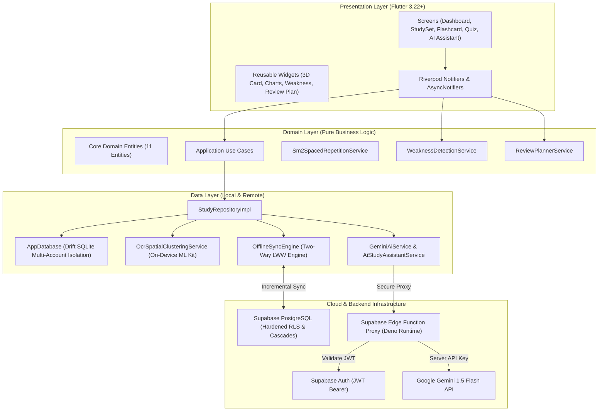
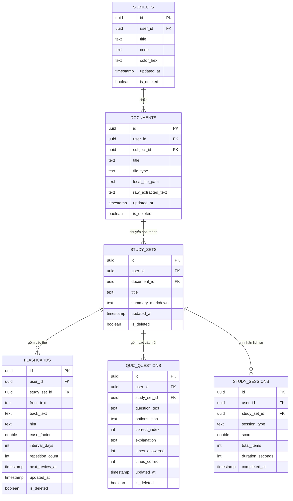
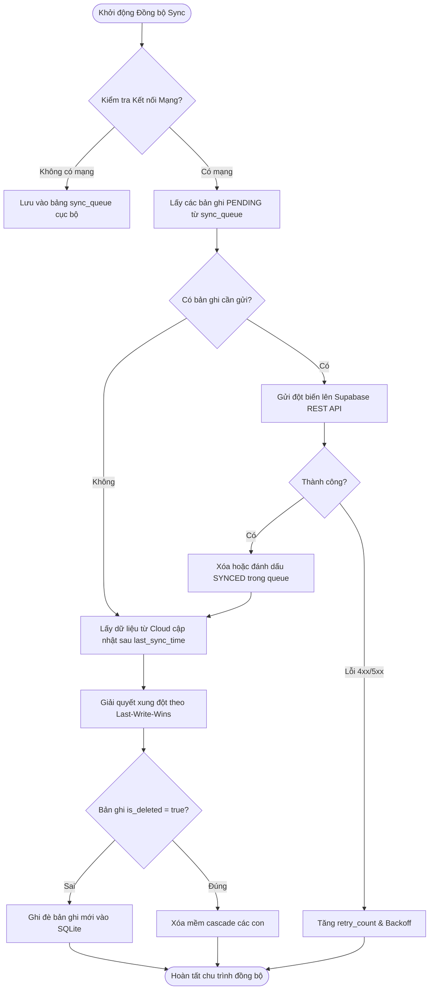
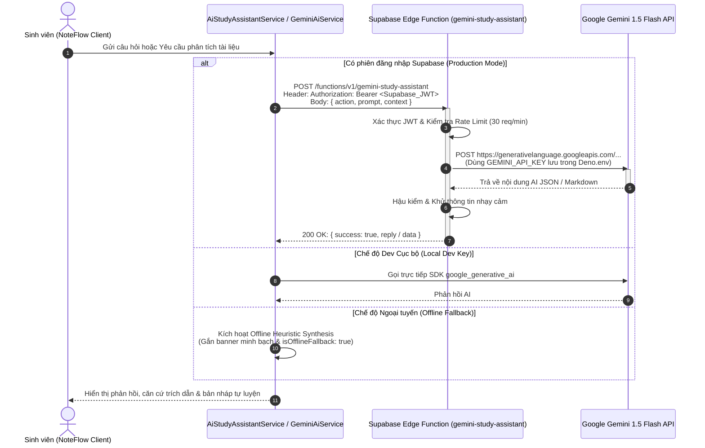

# TÀI LIỆU THIẾT KẾ KIẾN TRÚC KỸ THUẬT NOTEFLOW AI
## Technical Architecture Specification & Deep-Dive Engineering Reference

- **Dự án:** NoteFlow (VKU Intelligent Learning Assistant)
- **Cơ quan:** Khoa Khoa học Máy tính — Trường Đại học Công nghệ Thông tin và Truyền thông Việt - Hàn (VKU)
- **Phiên bản:** 1.0.0 (Release Candidate / Phase 5)
- **Tác giả:** Đội ngũ Kiến trúc sư Phần mềm & Kỹ sư An ninh NoteFlow

---

## 1. KIẾN TRÚC TỔNG THỂ HỆ THỐNG (SYSTEM ARCHITECTURE)

NoteFlow được xây dựng theo kiến trúc **Clean Architecture 3 lớp** kết hợp với mô hình quản lý trạng thái phản ứng **Riverpod 2**. Hệ thống tuân thủ nguyên tắc Dependency Inversion: tầng Domain hoàn toàn độc lập với UI framework và các thư viện bên ngoài.



---

## 2. BIỂU ĐỒ TRƯỜNG HỢP SỬ DỤNG (USE CASE DIAGRAM)

```mermaid
graph LR
    actor Student as "Sinh viên VKU"
    
    subgraph NoteFlow_System["Hệ thống Trợ lý Học tập NoteFlow AI"]
        UC1["1. Quét tài liệu & Nhận diện chữ OCR"]
        UC2["2. Sinh bộ học liệu AI (Tóm tắt, Flashcard, Quiz)"]
        UC3["3. Ôn tập Flashcard theo lịch SuperMemo SM-2"]
        UC4["4. Tham gia phòng thi trắc nghiệm Quiz bấm giờ"]
        UC5["5. Hỏi đáp chuyên sâu cùng Trợ lý AI Study Assistant"]
        UC6["6. Theo dõi phân tích điểm yếu học tập (Weakness Diagnosis)"]
        UC7["7. Thực hiện kế hoạch ôn tập cá nhân hóa hằng ngày"]
        UC8["8. Đồng bộ học liệu hai chiều ngoại tuyến (Offline-First Sync)"]
    end

    Student --> UC1
    Student --> UC2
    Student --> UC3
    Student --> UC4
    Student --> UC5
    Student --> UC6
    Student --> UC7
    Student --> UC8
```

---

## 3. THIẾT KẾ CƠ SỞ DỮ LIỆU & QUAN HỆ THỰC THỂ (DATABASE ERD)

Dữ liệu cục bộ được quản lý bằng Drift ORM (SQLite) và đồng bộ 1:1 với PostgreSQL trên Supabase Cloud.



---

## 4. XÁC THỰC, PHÂN QUYỀN & BẢO VỆ DỮ LIỆU (AUTH & RLS SECURITY)

### 4.1. Row-Level Security (RLS) & Chống IDOR
Toàn bộ 6 bảng dữ liệu trên Supabase đều kích hoạt `ENABLE ROW LEVEL SECURITY`.
Trong bản di trú hardening `20261122000000_harden_rls_foreign_key_ownership.sql`, lỗ hổng Insecure Direct Object Reference (IDOR) bị triệt tiêu bằng cách xác thực quyền sở hữu quan hệ cha-con:
```sql
CREATE POLICY "Users can insert own flashcards" ON public.flashcards
FOR INSERT WITH CHECK (
    auth.uid() = user_id
    AND EXISTS (
        SELECT 1 FROM public.study_sets ss
        WHERE ss.id = study_set_id
          AND ss.user_id = auth.uid()
    )
);
```

### 4.2. Cách ly Tài khoản Cục bộ (SQLite Multi-Account Isolation)
Mỗi tài khoản đăng nhập sở hữu một tệp cơ sở dữ liệu vật lý riêng biệt:
- Người dùng khách (chưa đăng nhập): `noteflow_ai_guest.sqlite`
- Người dùng đã xác thực: `noteflow_user_<sanitized_user_id>.sqlite`
Khi người dùng đăng xuất hoặc chuyển tài khoản, Riverpod tự động giải phóng (`ref.onDispose(db.close)`) và mở tệp tương ứng với user mới, ngăn chặn tuyệt đối tình trạng rò rỉ dữ liệu giữa các sinh viên dùng chung thiết bị.

---

## 5. ĐỒNG BỘ HAI CHIỀU NGOẠI TUYẾN (OFFLINE-FIRST SYNC ENGINE)

### 5.1. Luồng Hoạt động Đồng bộ (Flowchart)



---

## 6. ĐƯỜNG ỐNG XỬ LÝ OCR (ON-DEVICE VISION PIPELINE)

1. **Thu nhận ảnh & Cắt chuẩn hóa:** `image_picker` chụp ảnh tài liệu, `image_cropper` (`UCropActivity`) hỗ trợ xoay và nắn góc nhìn.
2. **On-Device Text Recognition:** Google ML Kit Text Recognition phân tích các `TextBlock`, `TextLine` và `TextElement` trực tiếp trên CPU/NPU thiết bị (hoàn toàn ngoại tuyến).
3. **Spatial Row Clustering:**
   - Sắp xếp các phần tử từ trên xuống dưới theo `boundingBox.top`.
   - Gom các phần tử có độ chồng lấp trục tung $\ge 55\%$ vào cùng một dòng ảo:
     $$\text{Overlap}(A, B) = \frac{\min(A_{\text{bottom}}, B_{\text{bottom}}) - \max(A_{\text{top}}, B_{\text{top}})}{\min(A_{\text{height}}, B_{\text{height}})} \ge 0.55$$
   - Phân tách cột: Nếu khoảng cách ngang vượt quá $2.4\times$ chiều cao ký tự trung bình, hệ thống giữ nguyên khoảng cách định dạng đa cột.

---

## 7. TÍCH HỢP GEMINI AI & SUPABASE EDGE FUNCTION PROXY

### 7.1. Trình tự Gọi API Bảo mật (Sequence Diagram)



---

## 8. THUẬT TOÁN KHOA HỌC NHẬN THỨC SUPERMEMO SM-2

Hàm cập nhật chu kỳ ôn tập Spaced Repetition thực thi độc lập tại `Sm2SpacedRepetitionService`:
- **Đánh giá phản hồi $q \in \{1, 2, 4, 5\}$:**
  - $q = 1$ (Again)
  - $q = 2$ (Hard)
  - $q = 4$ (Good)
  - $q = 5$ (Easy)
- **Hệ số dễ (Ease Factor $EF'$):**
  $$EF' = \max\left(1.3, EF + \left(0.1 - (5 - q) \cdot (0.08 + (5 - q) \cdot 0.02)\right)\right)$$
- **Khoảng cách ngày ôn tập tiếp theo ($I$):**
  $$I(n) = \begin{cases} 
  1 & \text{khi } q < 3 \\ 
  1 & \text{khi } q \ge 3 \text{ và } n = 1 \\ 
  6 & \text{khi } q \ge 3 \text{ và } n = 2 \\ 
  \text{round}(I(n-1) \cdot EF') & \text{khi } q \ge 3 \text{ và } n > 2 
  \end{cases}$$

---

## 9. THUẬT TOÁN CHẨN ĐOÁN ĐIỂM YẾU HỌC TẬP (WEAKNESS DETECTION)

Điểm tổng hợp độ yếu $S \in [0, 100]$:
$$S = w_f \cdot S_f + w_q \cdot S_q$$
- $S_f = \text{clamp}\left(0, 100, \frac{\overline{\text{ease}}}{2.5} \cdot 100 - \min(30, \text{overdueCount} \cdot 5)\right)$
- $S_q = \left(\frac{\text{correctAnswers}}{\text{totalAnswered}}\right) \cdot 100$

**Trọng số thích ứng:**
- Khi có cả Flashcard và Quiz: $w_f = 0.6, w_q = 0.4$.
- Khi chưa có Quiz (Case A) hoặc chỉ học Flashcard (Case C): $w_f = 1.0, w_q = 0.0$.
- Khi chỉ làm Quiz mà chưa ôn Flashcard (Case D): $w_f = 0.0, w_q = 1.0$ (tránh hiện tượng điểm flashcard mặc định kéo sai lệch kết quả).
- Mẫu thử nhỏ (Case B) và thiếu dữ liệu tương tác (Case E: $< 3$ tương tác): Gắn cờ cảnh báo `isInsufficientData: true`.

---

## 10. KẾ HOẠCH ÔN TẬP CÁ NHÂN HÓA (PERSONALIZED REVIEW PLANNER)

Nhiệm vụ được tạo ra theo 3 nhóm ưu tiên:
1. **Nhiệm vụ Khẩn cấp (`urgent`):** Các thẻ flashcard quá hạn ôn tập ($next\_review\_at \le now$).
2. **Nhiệm vụ Điểm yếu (`weaknessDrill`):** Các chủ đề có mức độ nghiêm trọng `critical` ($S < 40$) hoặc `moderate` ($40 \le S < 60$).
3. **Nhiệm vụ Củng cố (`quizReinforcement`):** Ôn lại các câu hỏi trắc nghiệm có tỷ lệ trả lời đúng thấp.

**Quy tắc an toàn hoàn thành (Session Safety):**
Chỉ đánh dấu hoàn thành nhiệm vụ khi tổng số thẻ thực học trong ngày thỏa mãn:
$$\text{totalReviewedCardsToday} \ge \text{overdueCardsCount}$$

---

## 11. CHIẾN LƯỢC KIỂM THỬ TOÀN DIỆN (TESTING STRATEGY)

Hệ thống kiểm thử tự động gồm 76 bài test phân tầng nghiêm ngặt:
- **Unit Tests (test/domain, test/data):** Kiểm thử thuật toán SM-2, OcrSpatialClustering, WeaknessDetectionService (Cases A-E), ReviewPlannerService (Session Safety), Citation Validation.
- **Widget Tests (test/presentation):** Kiểm thử giao diện M3, Sticky Action Bar, AI Study Assistant screen, Daily Review Plan card.
- **Local Integration Tests (test/integration):** Kiểm thử đường ống end-to-end với Drift in-memory SQLite (`NativeDatabase.memory()`).
- **External Cloud Boundary:** Kiểm thử tự động tuyệt đối không kết nối mạng ra ngoài; sử dụng Heuristic Fallback và Fake Repositories để đảm bảo tính tất định (deterministic) 100%.

---

## 12. QUY TRÌNH ĐÓNG GÓI BẢN PHÁT HÀNH (RELEASE PROCESS)

1. **Kiểm tra an toàn tĩnh:** Chạy `flutter analyze` (đạt 0 lỗi) và `dart format`.
2. **Chạy kiểm thử hồi quy:** Chạy `flutter test` (đảm bảo 100% 76 tests pass).
3. **Biên dịch Release APK an toàn:**
   ```bash
   flutter build apk --release --dart-define=GEMINI_API_KEY=""
   ```
4. **Kiểm tra Artifact:** File APK được tạo tại `build/app/outputs/flutter-apk/app-release.apk` (dung lượng 95.4MB), đảm bảo không chứa API Key nhúng nguyên văn trong `libapp.so`.
